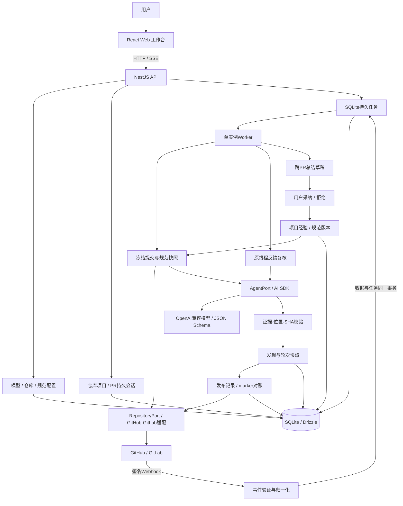

# 实现架构

## 一次完整工作流

1. 用户绑定模型和仓库，配置规范，导入 PR。唯一键 `projectId:number` 将多次导入映射为同一个会话。
2. 手动审查或签名 PR 事件创建持久任务。Webhook 入库后立即确认，不在接收请求中等待模型。
3. Worker 读取远端 PR、diff 与指定 SHA 的文件上下文；冻结审查输入。一个任务对应一个确定的 run ID，重试不改变规范或模型配置。
4. AI 返回结构化审查结果。工作流校验文件、行号与原文依据，并再次读取最新 head。过时结果标记为 superseded，不发布。
5. 结果先保存本地；自动发布开启或用户手动发布后，对每个发现及概览建立 publication。先从远端评论中查 marker，再决定是否写入。
6. 新提交进入同一会话的下一轮。与当前已知问题匹配的发现复用身份，已解决问题重新出现会再次通知；不同位置采用新发现。只有代码覆盖充分时才允许标记旧问题已解决。
7. 问题线程的用户回复进入 reply 任务。Agent 结合最新代码复核，生成一次回复并保存，再以 publication 对账发送，避免重试时生成不同回复。私有聊天使用独立 chat 任务。
8. 关闭或已有反馈的 PR 提供跨 PR 总结材料。生成带会话来源的草稿；人工采纳后进入项目经验或规范，不自动扩散至其他项目。

## 关键边界

API 不直接调用模型完成审查；业务工作流只依赖 RepositoryPort、AgentPort、Store。平台差异留在适配器中。Web 不接触凭据，也不自己拼装 Agent 的审查上下文。

SQLite 使用 15 张业务表。业务实体、状态、身份与关联使用明确列、外键、复合外键、唯一约束及 CHECK；文件材料、模型上下文和来源证据保留 JSON。`storage/schema.ts` 是类型化 Schema，`storage/repositories` 负责业务查询与存取，`Store` 仅持有连接、Repository 和事务。

会话与 PR 代码快照分开；快照按提交基线、描述、文件材料和覆盖范围共同计算身份。`review_runs` 引用代码快照和规范版本，执行状态与 `superseded_at` 独立。跨轮次问题身份在 `findings` 中，具体结论在 `review_run_findings` 中，不可通过更新当前问题覆盖历史结论。API 的旧 `status` 字段仍兼容地展示过时状态，另提供 `executionStatus`。

规范修改新增 `project_standard_versions`。经验来源与生成时的证据写入 `experience_sources`，采纳规范建议时，创建版本和更新审批状态在同一事务内完成。凭据引用替代重复保存的 `hasToken` 等状态，接口中的标记由引用推导。

每条 publication 通过实际外键关联审查概览、该轮问题结论或消息中的一个来源，CHECK 限制三者互斥。正文、快照和发送目标在创建意图时冻结；只有投递状态与远端身份可以更新。数据库触发器保护快照、规范版本、每轮结论、来源证据及发布意图。

`apps/server/sql` 按表保存当前初始化 SQL：一张业务表一个文件，包含该表的索引和触发器。`storage/initialize-database.ts` 在同一个 SQLite 事务中执行 `CREATE ... IF NOT EXISTS`，不维护数据库迁移版本、元数据账本或旧结构升级逻辑，也不自动清空已有数据。SQL 与 `storage/schema.ts` 同步维护；已有数据库的结构调整由开发者先备份再手动处理。构建和部署需要保留 SQL 目录。这一约定只影响数据库结构管理，项目规范版本与审查历史仍完整保存。

写操作仍由同一个实例协调。后台队列使用 SQL 原子认领任务；此实现面向单 Worker，不承担分布式队列职责。

新任务产生、状态变更与结果落库通过 SSE 使前端 Query 缓存失效。SSE 断开不影响 Worker 执行，页面重新连接后重新读取持久状态。

## 源码职责

- `main.ts` 与 `runtime`：启动、静态文件、进程锁和退出。
- `app.ts` / `app.module.ts`：Nest 装配和依赖注入。
- `http/controllers`：按模型、项目、会话、经验、任务和 Webhook 接收请求。
- `configuration`：模型配置、仓库配置、经验审批和环境校验。
- `workflow/workflow.ts`：接收业务命令并分派带类型的任务。
- `workflow/*.service.ts`：审查、发布、聊天/回复、总结、事件各自实现。
- `workflow/review-validation.ts`：独立处理证据、diff 定位、覆盖范围与解决结论的校验。
- `jobs/worker.ts`：串行执行与停止。
- `integrations/repository-client.ts`：平台 HTTP、认证、超时、响应上限与分页。
- `integrations/repository.ts` / `agent.ts` / `webhook.ts`：仓库操作、模型协议和事件适配。
- `storage`：类型化 Schema、数据库初始化、关系型数据及持久队列。
- `apps/server/sql`：按表组织的当前初始化 SQL、索引和触发器。
- `packages/contracts/src`：按领域维护共享 DTO、Zod 校验与任务判别联合。

前端 `App.tsx` 仅保留工作台装配和导航；`features` 按模型、项目、会话、经验、任务和工作区组织界面，通用组件位于 `components`。
